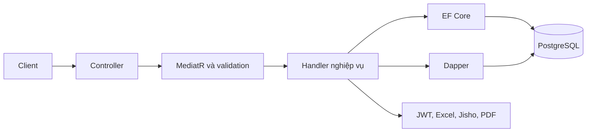

# Kiến trúc và luồng nghiệp vụ

## Các lớp

| Project | Trách nhiệm hiện tại |
| --- | --- |
| `JlptTrainer.Api` | ASP.NET Core controllers, JWT bearer, Swagger, CORS và middleware xử lý lỗi. |
| `JlptTrainer.Application` | Commands, queries, handlers, DTO và FluentValidation. MediatR chạy validation behavior trước handler có validator. |
| `JlptTrainer.Domain` | Entity học liệu, người dùng, thẻ ôn, bài đã nộp và các enum nghiệp vụ. |
| `JlptTrainer.Infrastructure` | EF Core/Npgsql và migrations, Dapper cho dashboard, BCrypt/JWT, EPPlus, QuestPDF và HTTP client gọi Jisho. |

## Tài khoản

`POST /api/auth/register` chuẩn hóa email, kiểm tra trùng, hash mật khẩu qua BCrypt, lưu user và phát JWT. `POST /api/auth/login` tìm user theo email đã chuẩn hóa, xác minh mật khẩu và phát JWT. Các nhóm API khác yêu cầu bearer token. Handler cần dữ liệu cá nhân lấy ID từ claim qua `ICurrentUserService`. Xem [Auth handlers](../src/JlptTrainer.Application/Auth/Commands) và [Program.cs](../src/JlptTrainer.Api/Program.cs).

PostgreSQL yêu cầu `UserId` hợp lệ khi ghi thẻ ôn, kết quả bài luyện hoặc phiên học. Khóa ngoại chặn xóa người dùng còn dữ liệu học tập để tránh mất dữ liệu ngoài quy trình xử lý tài khoản. [Migration ràng buộc dữ liệu](../src/JlptTrainer.Infrastructure/Migrations/20261118132437_StrengthenLearningDataConstraints.cs).

`POST /api/auth/change-password` yêu cầu bearer token, `currentPassword` và `newPassword`. Handler lấy tài khoản từ token, kiểm tra mật khẩu hiện tại, hash mật khẩu mới và tăng phiên bản thông tin đăng nhập trong cùng lần lưu. Thành công trả `204`. Mật khẩu hiện tại sai hoặc mật khẩu mới không hợp lệ trả `400`. JWT được phát trước khi đổi mật khẩu bị từ chối ở lần gọi endpoint bảo vệ tiếp theo. [Handler đổi mật khẩu](../src/JlptTrainer.Application/Auth/Commands/ChangePassword/ChangePasswordCommandHandler.cs).

`POST /api/auth/forgot-password` nhận `email` và trả `202` cùng thông báo chung khi yêu cầu vào hàng đợi. Worker tra email và gửi link qua Gmail nếu tài khoản tồn tại. Mỗi tài khoản nhận tối đa một lần gửi mỗi phút và link có hạn 15 phút. Hai endpoint khôi phục có giới hạn yêu cầu theo IP.

`POST /api/auth/reset-password` nhận `token` và `newPassword`. Database lưu hash của token. Lần đặt lại thành công xóa token và tăng phiên bản thông tin đăng nhập trong cùng lần lưu, trả `204`. Link sai, hết hạn hoặc đã dùng trả `400`. Người dùng đăng nhập lại bằng mật khẩu mới. [Handler đặt lại mật khẩu](../src/JlptTrainer.Application/Auth/Commands/ResetPassword/ResetPasswordCommandHandler.cs).

## Kho học liệu

- `/api/vocabs`, `/api/kanjis`, `/api/grammarpoints` có GET danh sách theo cấp JLPT với phân trang, GET chi tiết, POST thêm và DELETE theo ID. Ba nhóm dùng kho học liệu chung. Controller hiện cho mọi tài khoản đã xác thực đọc, thêm, nhập và xóa học liệu.
- `GET /api/vocabs/lookup` tra từ qua Jisho để gợi ý cách viết, cách đọc và nghĩa tiếng Anh. Muốn lưu vào kho cần gọi luồng tạo vocab riêng.
- Mỗi nhóm có `GET import/template` tải mẫu và `POST import` nhận file Excel. Controller đọc file, EPPlus đọc sheet đầu và dùng dòng đầu làm header. Handler kiểm tra trường bắt buộc và cấp độ, bỏ dòng trùng theo khóa của từng loại, ghi các mục hợp lệ rồi trả số dòng thành công, số dòng trùng và lỗi theo dòng. Cấp độ trống mặc định N5.
- Khi xóa học liệu, handler xóa các thẻ ôn cùng loại và ID tham chiếu rồi lưu thay đổi. Việc này ảnh hưởng tới mọi người học đã thêm mục đó.

Xem [controllers](../src/JlptTrainer.Api/Controllers) và [Excel reader](../src/JlptTrainer.Infrastructure/ExcelImport/EPPlusExcelReader.cs).

## Ôn tập cá nhân

1. `POST /api/reviewcards` nhận loại học liệu và ID. Handler kiểm tra học liệu tồn tại và chống thêm lại cùng mục cho một user. Thẻ mới đến hạn ngay với ease factor 2.5.
2. `GET /api/reviewcards/due` lấy thẻ của user có lịch đến hạn theo UTC, ưu tiên thẻ trễ lâu. DTO chứa loại và ID tham chiếu để client tra nội dung học liệu.
3. `POST /api/reviewcards/{id}/review` kiểm tra chủ thẻ rồi nhận mức Again, Hard, Good hoặc Easy. Biến thể SM-2 đặt lại repetitions về 0 và hẹn ngày mai khi Again. Hai lần nhớ đúng đầu tiên dùng khoảng 1 và 6 ngày. Các lần tiếp theo nhân khoảng cũ với ease factor, rồi điều chỉnh ease factor theo mức chấm.
4. Handler cập nhật lịch và `LastReviewedAt` ngay trên thẻ. Route review có thể ghi nhận ôn sớm vì handler hiện kiểm tra quyền sở hữu và grade, chưa áp ngày đến hạn cho thao tác ghi.

Xem [ReviewCards](../src/JlptTrainer.Application/ReviewCards).

## Bài luyện từ vựng

1. `GET /api/mocktests/questions` lấy pool vocab theo cấp JLPT. Có ít nhất bốn vocab thì handler chọn câu ngẫu nhiên và lấy ba nghĩa nhiễu từ cùng cấp. Số câu thực tế tối đa bằng số vocab trong pool. Thiếu pool trả 422.
2. `POST /api/mocktests/submit` nhận cấp, thời lượng và danh sách vocab cùng nghĩa đã chọn. Handler tra nghĩa hiện tại trong DB, so khớp chuỗi sau khi trim và bỏ qua hoa thường, sau đó ghi tổng số câu, số đúng và thời điểm nộp. Schema hiện lưu bản tổng kết, chưa lưu đề, phương án hoặc từng câu trả lời.
3. `GET /api/mocktests/history` lấy lịch sử của user. `GET /api/mocktests/{id}/pdf` kiểm tra chủ bài và xuất bản tổng kết bằng QuestPDF.

Xem [MockTests](../src/JlptTrainer.Application/MockTests).

## Dashboard

- `GET /api/dashboard/heatmap` gọi `get_study_heatmap` để nhóm các thẻ theo ngày UTC của lần ôn gần nhất trong khoảng yêu cầu. Các ngày không có bản ghi không xuất hiện trong kết quả.
- `GET /api/dashboard/progress` gọi `get_card_progress` để đếm tổng thẻ và thẻ có ít nhất ba repetitions theo loại. `get_mock_test_trend` tính điểm trung bình theo ngày UTC và cấp JLPT.
- `StudySession` đã có entity và bảng nhưng luồng review hiện ghi trực tiếp vào `ReviewCard`. Heatmap đọc trạng thái mới nhất của thẻ.

Xem [Dashboard handlers](../src/JlptTrainer.Application/Dashboard/Queries) và [migration SQL](../src/JlptTrainer.Infrastructure/Migrations/20260802112353_AddDashboardFunctions.cs).

Thứ tự ưu tiên, rủi ro dữ liệu và kết quả kiểm thử nằm trong [review kỹ thuật](technical-review.md).
